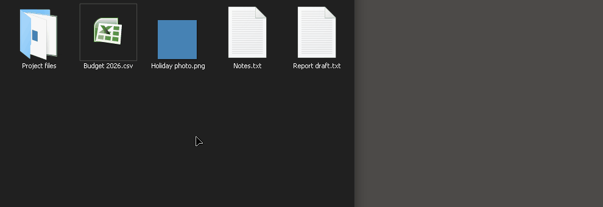
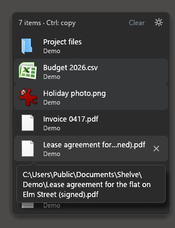
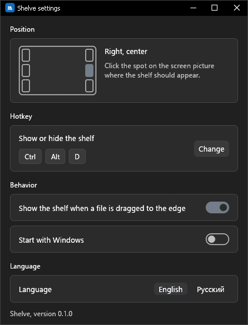

# Shelve

A file shelf at the edge of the screen, for Windows 10 and 11.



Start dragging a file, bring it to the edge of the screen, and a small panel slides out. Drop the file there. Then open the folder or the program it should go to and drag it off the shelf.

The shelf only remembers where the files are. Nothing is copied or moved until you drag an item out. Dragged out with the left mouse button, it moves; hold Ctrl when you let go to get a copy.

На русском: [README.ru.md](README.ru.md)

## Install

Download `shelve.exe` from the [latest release](../../releases/latest), put it in any folder and run it. There is no installer and it does not need administrator rights. An icon appears in the tray.

The file is not signed, so the first time you run it Windows SmartScreen shows a warning: click "More info", then "Run anyway". The release page has a SHA-256 checksum next to the file if you want to check the download.

Settings are kept in `%APPDATA%\shelve\config.json`. To remove Shelve, turn off "Start with Windows" in its settings, exit it from the tray menu, then delete the exe and that folder.

## Use



- **Put a file on it.** Drag a file or a folder to the screen edge (the right one by default) and drop it on the shelf when it slides out. `Ctrl+Alt+D` or "Show/hide" in the tray menu opens the shelf without dragging anything.
- **Take a file off it.** Drag a row into a folder or onto the desktop with the left mouse button and the file moves there. Its row leaves the shelf once Explorer has finished moving it: usually at once, for a big file going to another drive when the copying is done. Shelve itself never deletes anything.
- **Copy instead.** Hold Ctrl when you let go: the file is copied and the row stays. The header reminds of it: "3 items · Ctrl: copy". Dragged with the right mouse button, the file brings up the Windows menu on the drop (Copy here, Move here); click the one you want.
- A program window (a messenger, a browser) takes the file the way the program decides, usually as a copy.
- A row dropped on the Recycle Bin window sends the file to the Recycle Bin, and the row leaves the shelf. Explorer does that, not Shelve; the file can be restored from the Recycle Bin.
- **Remove a row.** Point at it and click the cross on the right. "Clear" in the header removes all rows. The files themselves are not touched.
- A file that was deleted or renamed in the meantime is shown grey and struck through. It cannot be dragged out; a click removes its row.
- **Bring it back.** While the shelf is hidden with files on it, a small tab in the shelf's colours, with an arrow pointing into the screen, stays at the screen edge where the shelf is. It lights up in the accent colour under the mouse. Rest the mouse on it for a moment or click it, and the shelf comes out. A mouse just passing by does not open it. A left click on the tray icon or `Ctrl+Alt+D` also opens the shelf and closes it again; a right click on the tray icon opens its menu.
- The shelf hides by itself once the mouse buttons are up, the cursor is off the shelf, and a second and a half has passed. A shelf opened with the hotkey or from the tray waits until the cursor has been on it at least once, so it does not hide while you move the mouse over to it.
- The shelf starts empty every time Shelve is started.

The shelf is light or dark like Windows and uses the Windows accent colour. If animation effects are turned off in Windows, nothing on the shelf is animated.

## Settings



Click the gear on the shelf, or "Settings" in the tray menu.

- **Position.** Click one of the six spots on the picture of the screen: left or right edge; top, centre or bottom.
- **Hotkey.** Click "Change" and press the new combination. Esc cancels. If another program already holds the combination, Shelve says so and keeps the old one.
- **Behavior.** Whether the shelf comes out when a file is dragged to the edge, and whether Shelve starts with Windows. Autostart is set for the current user only.
- **Language.** English or Russian.

Changes apply at once.

## Limitations

- Windows 10 and 11 only.
- Tried on one monitor. With several monitors the border between two of them is not a screen edge: an edge that has another monitor next to it, even along part of its height, does not open the shelf. On monitors with different scaling the shelf may come out the wrong size.
- The exe is not signed, hence the SmartScreen warning.
- About 55 MB of memory after start; see below for where it goes.
- Windows does not allow drag and drop between a normal program and one running as administrator. If Shelve runs without administrator rights, files cannot go from such a window to the shelf or back.
- A full-screen game or video can cover the shelf.
- The shelf comes out only for files and folders. Dragging text, links or windows to the edge does nothing.
- A hotkey with the Win key cannot be set in the settings window. Ctrl, Alt and Shift work.

## Resources

Measured on Windows 10 22H2 with an NVIDIA card at 100% scale, release build.

| | |
|---|---|
| Size of the exe | 5.2 MB |
| Memory after start, shelf hidden | 55 MB |
| Memory with the shelf shown and a few files on it | 65 to 70 MB |
| Memory with the shelf hidden again | 5 to 8 MB |
| CPU while idle | none |

Almost all of the 55 MB belongs to the graphics driver that Windows loads into the program together with its window; Shelve without a window takes about 8 MB. On another graphics card the numbers will differ. Every time the shelf hides, Shelve hands the memory it is not using back to Windows, which is why the number drops so far after the first use.

## Build from source

You need Rust (stable).

With Visual Studio Build Tools:

```
cargo +stable-x86_64-pc-windows-msvc build --release
```

Without them, install the `stable-x86_64-pc-windows-gnullvm` toolchain, put [llvm-mingw](https://github.com/mstorsjo/llvm-mingw) on `PATH` and run:

```
cargo build --release
```

Either way the result is `target/release/shelve.exe`, a single file with no DLLs to carry along.

The checks that CI runs:

```
cargo fmt --all --check
cargo clippy --workspace --all-targets -- -D warnings
cargo test --workspace
```

The code is in three crates: `crates/core` (the shelf, the settings, the rules for showing and hiding, the interface texts; no Windows code), `crates/platform` (tray, hotkey, autostart, mouse hook, drag and drop, file icons) and `crates/app` (the windows, drawn with egui).

## License

[MIT](LICENSE-MIT) or [Apache 2.0](LICENSE-APACHE), whichever you prefer.
