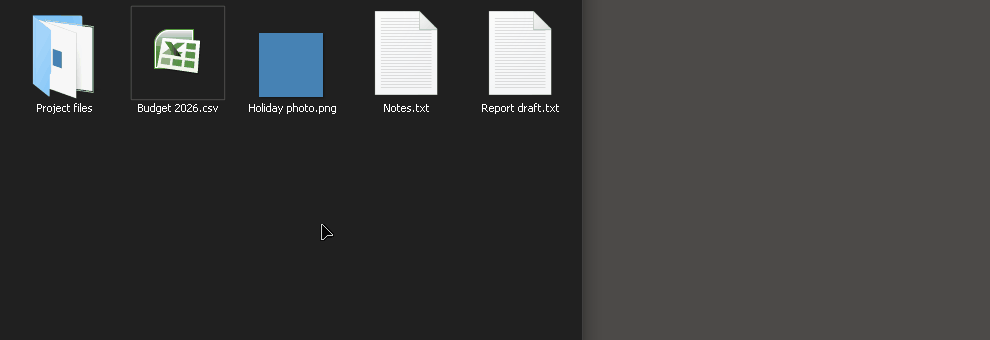
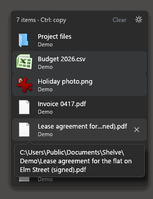
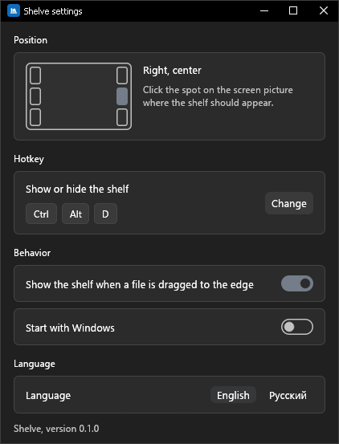

# Shelve

Полка для файлов у края экрана, для Windows 10 и 11.

In English: [README.md](README.md)



Начните тащить файл, доведите его до края экрана, и оттуда выедет небольшая плашка. Бросьте файл на неё. Потом откройте папку или программу, куда файл нужен, и перетащите его с полки туда.

Полка хранит только ссылки на файлы. Ничего не копируется и не перемещается, пока вы сами не перетащите файл с полки. Левой кнопкой мыши файл переносится, а если при отпускании держать Ctrl, копируется.

## Установка

Скачайте `shelve.exe` со страницы [последнего релиза](../../releases/latest), положите в любую папку и запустите. Установщика нет, права администратора не нужны. У часов появится значок.

Файл не подписан, поэтому при первом запуске Windows SmartScreen покажет предупреждение: нажмите «Подробнее», затем «Выполнить в любом случае». Рядом с файлом на странице релиза лежит контрольная сумма SHA-256, если захотите проверить скачанное.

Настройки хранятся в `%APPDATA%\shelve\config.json`. Чтобы убрать Shelve, выключите в настройках «Запускать вместе с Windows», выйдите через меню значка у часов и удалите exe и эту папку.

## Язык

Программа запускается на английском. Русский включается так: значок Shelve у часов, «Settings», внизу окна строка «Language», кнопка «Русский». Выбор запоминается.

Дальше названия кнопок даны по-русски.

## Как пользоваться



- **Положить файл.** Тащите файл или папку к краю экрана (по умолчанию к правому) и бросьте на полку, когда она выедет. `Ctrl+Alt+D` или «Показать/скрыть» в меню значка открывает полку и без перетаскивания.
- **Достать файл.** Перетащите строку левой кнопкой мыши в папку или на рабочий стол, и файл переедет туда. Строка уходит с полки, когда Проводник закончит перенос: обычно сразу, а для большого файла на другой диск, когда закончится копирование. Сам Shelve ничего не удаляет.
- **Скопировать.** Держите Ctrl, когда отпускаете файл: будет копия, и строка останется. Об этом напоминает шапка: «3 объекта · Ctrl — копия». Если тащить правой кнопкой, при отпускании Windows покажет своё меню («Копировать», «Переместить»): щёлкните нужный пункт.
- В окно программы (мессенджер, браузер) файл попадает так, как решит сама программа, обычно как копия.
- Строка, брошенная в окно Корзины, отправляет файл в Корзину, и строка уходит с полки. Это делает Проводник, а не Shelve; файл можно восстановить из Корзины.
- **Убрать строку.** Наведите на неё мышь и нажмите крестик справа. «Очистить» в шапке убирает все строки. Сами файлы при этом не трогаются.
- Файл, который за это время удалили или переименовали, показан серым и зачёркнутым. Вытащить его нельзя, щелчок убирает строку.
- Полка, выехавшая для перетаскивания, прячется сама, когда вы отпустили кнопку мыши и увели курсор. Полка, открытая горячей клавишей, остаётся, пока вы не нажмёте клавишу ещё раз.
- После каждого запуска Shelve полка пустая.

Полка светлая или тёмная вслед за Windows и берёт цвет выделения Windows. Если в Windows выключены эффекты анимации, на полке ничего не анимируется.

## Настройки



Шестерёнка на полке или «Настройки» в меню значка у часов.

- **Расположение.** Щёлкните по одному из шести мест на картинке экрана: левый или правый край; сверху, по центру или снизу.
- **Горячая клавиша.** Нажмите «Изменить», затем новое сочетание. Esc отменяет. Если сочетание уже занято другой программой, Shelve скажет об этом и оставит прежнее.
- **Поведение.** Выезжает ли полка, когда файл тащат к краю, и запускается ли Shelve вместе с Windows. Автозапуск включается только для текущего пользователя.
- **Язык.** Английский или русский.

Всё применяется сразу.

## Ограничения

- Только Windows 10 и 11.
- Проверено на одном мониторе. При нескольких мониторах граница между ними не считается краем экрана: край, к которому примыкает другой монитор, хотя бы частью высоты, полку не открывает. На мониторах с разным масштабом полка может выйти не того размера.
- Файл не подписан, отсюда предупреждение SmartScreen.
- Около 55 МБ памяти после запуска; ниже написано, откуда они.
- Windows не даёт перетаскивать файлы между обычной программой и программой, запущенной от администратора. Если Shelve запущена без прав администратора, из такого окна файл на полку не положить и с полки в него не достать.
- Игра или видео во весь экран могут закрыть полку.
- Полка выезжает только для файлов и папок. Текст, ссылки и окна, которые тащат к краю, её не вызывают.
- Сочетание с клавишей Win в окне настроек задать нельзя. С Ctrl, Alt и Shift можно.

## Ресурсы

Замер на Windows 10 22H2, видеокарта NVIDIA, масштаб 100%, release-сборка.

| | |
|---|---|
| Размер exe | 5,2 МБ |
| Память после запуска, полка скрыта | 55 МБ |
| Память, когда полка показана и на ней несколько файлов | 65–70 МБ |
| Память, когда полка снова скрыта | 5–8 МБ |
| Процессор в простое | не занят |

Почти все 55 МБ принадлежат видеодрайверу, который Windows загружает в программу вместе с её окном; сама Shelve без окна занимает около 8 МБ. На другой видеокарте числа будут другими. Каждый раз, когда полка прячется, Shelve отдаёт Windows память, которой не пользуется, поэтому после первого использования число так падает.

## Сборка из исходников

Нужен Rust (stable).

С Visual Studio Build Tools:

```
cargo +stable-x86_64-pc-windows-msvc build --release
```

Без них: поставьте тулчейн `stable-x86_64-pc-windows-gnullvm`, добавьте [llvm-mingw](https://github.com/mstorsjo/llvm-mingw) в `PATH` и выполните:

```
cargo build --release
```

В обоих случаях получится `target/release/shelve.exe`: один файл, без DLL рядом.

Проверки, которые запускает CI:

```
cargo fmt --all --check
cargo clippy --workspace --all-targets -- -D warnings
cargo test --workspace
```

Код разложен по трём крейтам: `crates/core` (полка, настройки, правила показа и скрытия, тексты интерфейса; без кода Windows), `crates/platform` (значок у часов, горячая клавиша, автозапуск, хук мыши, перетаскивание, значки файлов) и `crates/app` (окна на egui).

## Лицензия

[MIT](LICENSE-MIT) или [Apache 2.0](LICENSE-APACHE), на ваш выбор.
